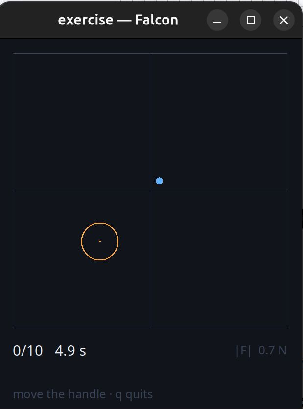
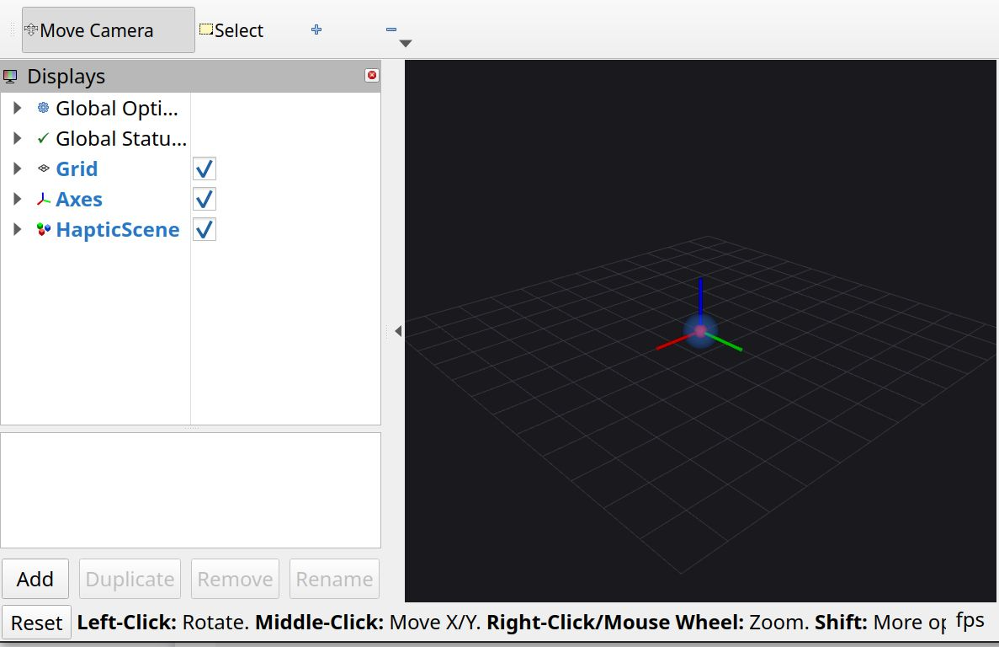

# Instructing rehabilitation robots with language models, over MCP

A therapist says what they want in ordinary language. A language model turns it
into a tool call. A deterministic validator decides whether that call may reach
the device — and the model can neither influence nor bypass it.

Semester project at the [Sensory-Motor Systems Lab](https://sms.hest.ethz.ch/),
ETH Zurich, for the EU **TAILOR** neuro-rehabilitation project. Demonstrated on
a Novint Falcon haptic device under ROS 2 Jazzy.

**[Read the report →](docs/report.pdf)**

---

## The idea

A rehabilitation robot takes its behaviour from the numerical parameters of its
controller, and a therapist has to find the right parameter, pick a value, and
set it through the device's own interface. A language model can do that step, if
something trustworthy stands between the model and the hardware.

That something is a **robot-agnostic core** exposed over the
[Model Context Protocol](https://modelcontextprotocol.io). Each device declares
itself in one YAML file — parameters, units, bounds, and a cap on how far one
command may move each value. The tool surface the model sees is generated from
that file, and every command is checked against it before anything moves.

```
adjustsettingsdemo ──MCP/stdio──> robot-control <──depends── falcon
   the model side            the robot-agnostic core        one device
```

Two invariants define the design:

1. **The server never imports a model.** No prompt logic, no sampling
   parameters, nothing model-shaped in the trusted core.
2. **The model side never imports ROS 2.** No device physics in the host, and no
   route to the hardware except the protocol.

Adding a robot is a new package with a `spec.yaml`, a backend, and one entry
point. Nothing in the core changes, and the core names no robot anywhere in its
source — `registry.known_robots()` reads the `robot_control.robots` entry-point
group at run time.

## Safety

Every command passes `robot_control/validator.py` server-side before any backend
runs: type, bounds, and a per-parameter rate cap judged against the state the
**device actually reports**, not the last commanded value. Validation is
**all-or-nothing** — if any parameter fails, the whole command is refused and
nothing is applied. `e_stop` latches; `resume` is a separate deliberate act. The
final force clamp lives in the C++ node, not in Python.

There is no code path from a tool call to a device that skips the validator.

From the evaluation in the report:

| | |
|---|---|
| Generated commands sent through the real server and validator | 20,000 |
| Invalid values that reached the device | **0** |
| Commands with one bad parameter among several: all refused, nothing applied | 2,000 of 2,000 |
| Commands after the emergency stop that reached the device | 0 of 500 |

A local 4-billion-parameter model (qwen3:4b under Ollama, on a laptop with no
discrete GPU) carried out **57%** of 42 annotated therapist instructions with
reasoning disabled, and **76%** with it enabled.

## The device and its exercises

The Falcon is a desktop haptic device: three motors move a handle through a
10 cm cube of workspace, applying up to about 9 N, clamped here to 8 N. It does
not drive the arm along a path — it pulls the handle towards a point, more or
less firmly, and the hand feels that pull.

It ships two exercises. Both declare their settings the way a robot declares
parameters, so they reach the model as validated tools.

| | |
|---|---|
|  | **Reach.** A dot appears, the patient moves the handle onto it and holds still, and the next one appears. Reports how long each reach took and how directly it was made. Optional assistance pulls towards the dot once the hand is already close. |
|  | **Haptic rendering.** Virtual objects the patient can feel: spheres, boxes, cylinders, ellipsoids, cones, meshes, walls, a pull towards a point, a thick fluid, a buzz. Rendered with CHAI3D's finger-proxy algorithm, so a solid cannot be pushed through by shoving harder. |

## Layout

```
robot-control/      the robot-agnostic core: spec format, validator, registry,
                    exercise contract, MCP server, prompts.
                    No robot, no model, no ROS 2 import.
falcon/             one device: backend, spec.yaml, both exercises, the CHAI3D
                    renderer, RViz and window viewers.
docs/report.pdf     the semester report
```

Each has its own README, and they are the long-form documentation:
[robot-control](robot-control/README.md) · [falcon](falcon/README.md).

## Quick start

No hardware needed — the full test suite runs without a robot, without ROS 2 and
without a model.

```bash
python -m venv .venv && source .venv/bin/activate
pip install -e robot-control        # first: the other depends on it
pip install -e falcon

python -c "from robot_control.registry import known_robots; print(known_robots())"
# -> (RobotEntry(name='falcon', package='falcon_robot'),)

cd robot-control && python -m pytest    # the core
cd ../falcon     && python -m pytest    # the device
```

Driving real hardware needs a Novint Falcon, the Force Dimension SDK, CHAI3D and
ROS 2 Jazzy. The [falcon README](falcon/README.md) has the device setup.

## What is not here

Two parts of the running system are other people's work and are left out.

**The model side, `adjustsettingsdemo`.** The host that talks to the therapist,
runs the model and speaks MCP. It extends the lab's own parameter-adjustment
demonstrator, so the code is not mine to publish. It is an ordinary MCP client
with no privileged path to the hardware — any MCP client works in its place, and
the core was developed against Claude Desktop and Claude Code as well.

**The ROS 2 driver node, `falcon_ros2`.** Sathvik Kadimisetty's driver
(BIROMED-Lab, University of Basel), MPL-2.0, which this project forked and
modified. The parts written for this project are here — the CHAI3D renderer and
the two scene messages — and
[`falcon/falcon_robot/ros2_ws/src/falcon_ros2/README.md`](falcon/falcon_robot/ros2_ws/src/falcon_ros2/README.md)
lists exactly what is missing and what you need to build the hardware path.

Everything else in this repository was written for this project.

## Status

Working: the robot-agnostic core with validator and audit trail; one device
driven end to end on real hardware; a latching emergency stop; two exercises
configured over MCP with viewers the robot ships; and a local model adjusting a
real robot's parameters.

Next: a second real device (ANYexo) — with one robot installed the
robot-agnostic claim is asserted rather than tested; a larger model on a bigger
host, which is a client-side change with no server changes; and HTTP+SSE
transport for a split interface-PC / robot-PC setup.

[](https://m8ven.ai/mcp/celaltrk-rehab-robot-mcp-19j8q9?s=readme)

## License

[MIT](LICENSE) © 2026 Celal Türkmen. The report in `docs/` is the submitted
semester thesis, minus the signed declaration forms.
